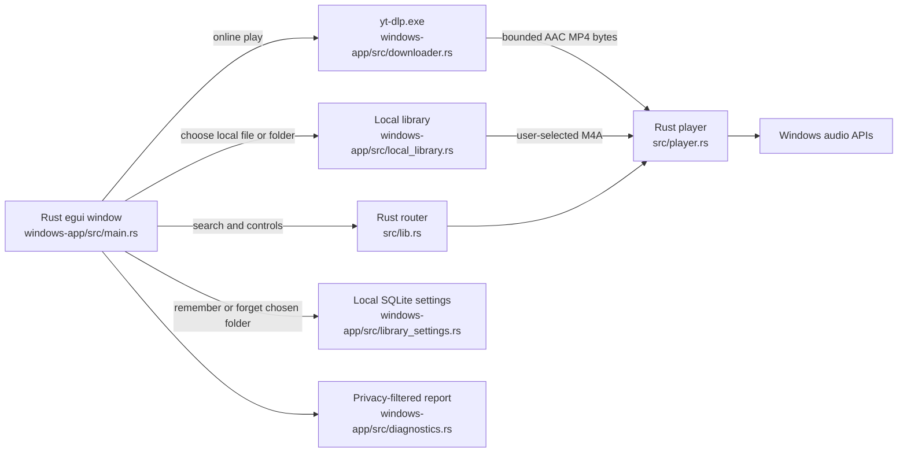

# Windows candidate architecture map (manual)

This is a hand-maintained Mermaid map, **not generated by Graphify**. Update it alongside relevant code changes. It is guidance, not authorization for provider probing or bypassing sign-in/bot challenges.

The user selected packaged yt-dlp for the Windows online component. It includes Python and is not a Rust rewrite. No auto-updater, separate Python installation, browser, or external Aysha server is used. Some provider content may remain unavailable. The local folder browser and offline M4A player do not use the provider. CI covers offline fixtures; it does not establish live-provider or physical-PC playback. Android is a separate Media3-based application with its own restrictions.
